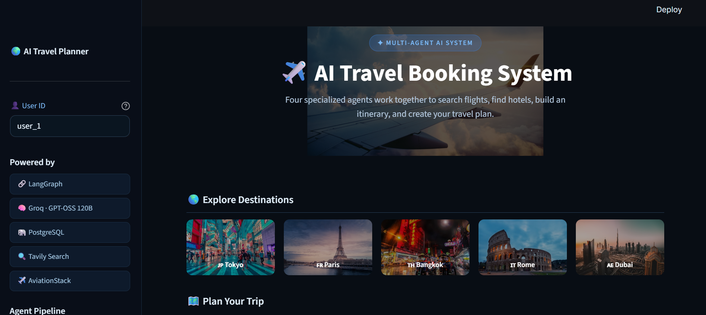
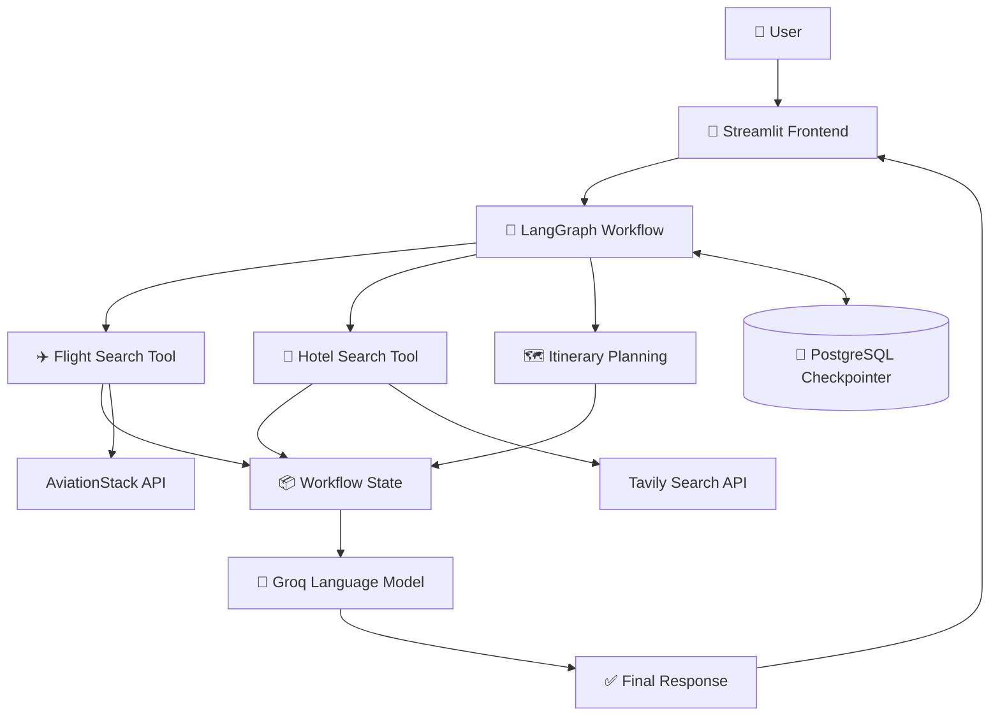

 <div align="center">

# ✈️ AI Travel Booking System

### Your Intelligent AI-Powered Travel Planning Assistant

Plan smarter. Discover destinations. Travel better.

     

[Overview](#-overview) · [Features](#-features) · [Architecture](#-architecture) · [Installation](#-installation) · [Usage](#-usage)

</div>

---

## 🌍 Overview

AI Travel Booking System is a Python-based, multi-agent AI application designed to make travel planning easier through a conversational interface.

The application combines AI agents, external APIs, web search and persistent workflow state to assist users with flight searches, hotel discovery and itinerary planning.

Built using LangGraph, LangChain, Groq and Streamlit, the project demonstrates how multiple AI components can work together to handle travel-related requests.

## 🖥️ Application Preview

<div align="center">
  
  <p><i>Application interface for AI-powered travel planning.</i></p>
</div>

## ✨ Features

<table>
<tr>
<td width="50%">

### ✈️ Flight Search

Retrieve flight information using the AviationStack API integration.

</td>
<td width="50%">

### 🏨 Hotel Discovery

Search for relevant hotel and travel information using web search tools.

</td>
</tr>
<tr>
<td width="50%">

### 🗺️ Itinerary Planning

Organize travel details into a structured itinerary based on the user's request.

</td>
<td width="50%">

### 🤖 Multi-Agent Workflow

Coordinate specialized tasks using LangGraph workflow orchestration.

</td>
</tr>
<tr>
<td width="50%">

### 💬 Interactive Interface

Submit travel requests and view responses through a Streamlit application.

</td>
<td width="50%">

### 💾 Persistent State

Use PostgreSQL-backed checkpointing to support workflow persistence.

</td>
</tr>
</table>

## 🏗️ Architecture



### Workflow

1. The user enters a travel-related request.
2. The Streamlit frontend passes the request to the application workflow.
3. LangGraph manages workflow execution and shared state.
4. Flight and hotel tools retrieve relevant information when required.
5. The itinerary-planning logic organizes the travel details.
6. The language model helps generate a clear response.
7. PostgreSQL checkpointing supports persistence across workflow execution.

*The exact execution sequence depends on the implementation in `main.py`.*

## 🧰 Technology Stack

| Technology | Purpose |
|---|---|
| Python | Core programming language |
| LangGraph | Workflow and agent orchestration |
| LangChain | LLM application framework |
| Groq | Language model inference |
| Streamlit | Interactive web interface |
| AviationStack | Flight data API integration |
| Tavily | Web search integration |
| PostgreSQL | Workflow checkpoint persistence |

## 📁 Project Structure

```text
AI-Travel-Booking-System/
│
├── main.py
├── frontend.py
├── requirements.txt
├── .gitignore
├── README.md
├── AI_Travel_Booking_System.png
│
└── tools/
    ├── flight_tool.py
    └── tavily_tool.py
```

## ⚙️ Installation

### 1. Clone the repository

```bash
git clone https://github.com/gryffin31/AI-Travel-Booking-System.git
```

### 2. Navigate to the project directory

```bash
cd AI-Travel-Booking-System
```

### 3. Create a virtual environment

```bash
python -m venv langgraph_env3
```

Activate the environment on Windows:

```powershell
.\langgraph_env3\Scripts\Activate.ps1
```

### 4. Install the dependencies

```bash
pip install -r requirements.txt
```

## 🔑 Configuration

Create a `.env` file in the project root and add your API credentials:

```env
GROQ_API_KEY=your_groq_api_key
TAVILY_API_KEY=your_tavily_api_key
AVIATIONSTACK_API_KEY=your_aviationstack_api_key
```

Configure the PostgreSQL connection according to the settings expected by your application.

Replace the example values with your own credentials. Never upload your `.env` file or expose API keys publicly.

## 🚀 Usage

Start the Streamlit application:

```bash
streamlit run frontend.py
```

Open the local URL displayed in the terminal.

Enter a travel request and use the application's available flight search, hotel discovery and itinerary-planning functionality.

## 🔗 Useful Resources

<div align="center">

<a href="https://www.python.org/" target="_blank">Python</a> ·
<a href="https://docs.langchain.com/oss/python/langgraph/overview" target="_blank">LangGraph</a> ·
<a href="https://python.langchain.com/" target="_blank">LangChain</a> ·
<a href="https://console.groq.com/docs" target="_blank">Groq API</a> ·
<a href="https://docs.streamlit.io/" target="_blank">Streamlit</a> ·
<a href="https://www.postgresql.org/docs/" target="_blank">PostgreSQL</a> ·
<a href="https://tavily.com/" target="_blank">Tavily</a> ·
<a href="https://aviationstack.com/documentation" target="_blank">AviationStack</a>

</div>

## 🔐 Security

- Keep API credentials inside environment variables.
- Ensure `.env` is included in `.gitignore`.
- Never commit passwords, secret keys or private database credentials.
- Use your own API credentials when running the application.

## 🔮 Future Enhancements

- Real-time booking integration
- Travel budget estimation
- Personalized travel recommendations
- Multi-city trip planning
- Improved agent monitoring and tracing
- Cloud deployment

## 👨‍💻 Author

**Gryffin31**

GitHub: [@gryffin31](https://github.com/gryffin31)

Project Repository: [AI Travel Booking System](https://github.com/gryffin31/AI-Travel-Booking-System)

---

<div align="center">

### ✈️ Smarter Travel Planning with Multi-Agent AI

If you find this project interesting, consider giving the repository a ⭐

</div>
